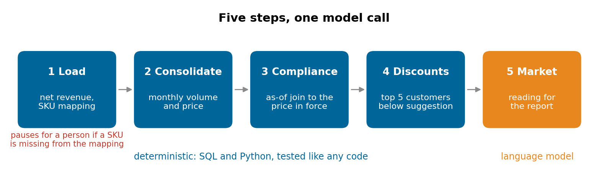
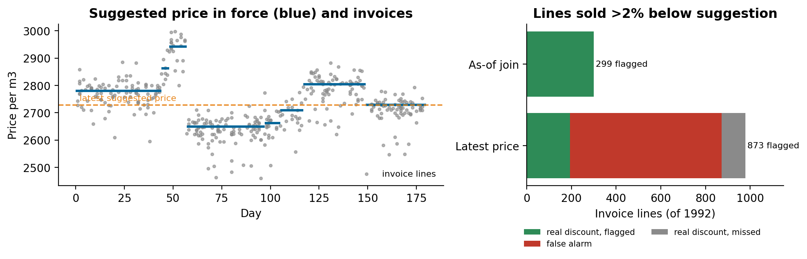

# Pricing review with an as-of join

A five-step pricing review where four steps are plain code: comparing each invoice with the suggested price in force on its date, against the latest-price shortcut.

Companion code for the article **[When only one of your AI agents needs an LLM](https://lucas.rangeltech.net/articles/h9-only-one-agent-needs-an-llm/)**.

## The problem

A weekly pricing review was designed as five AI agents. Four of the steps turned out to be calculations with exact answers, and the hard part was a date: the suggested-price table is revised every few weeks, and each invoice has to be compared with the price that was in force when it was issued.

This repository runs the review on synthetic data: about 2,000 invoice lines over six months for five sugar and ethanol products, a suggested-price table with several versions per product, and a SKU mapping that is missing one new product.

> All data in this repository is synthetic, generated by the scripts with a fixed seed, with the shape of a real client problem. No client data, names or code are included.

## What the code does

1. **Load:** net revenue per line; **pauses for a person** if a SKU is not in the mapping.
2. **Consolidate:** volume and price per product per month.
3. **Compliance:** each line against the suggested price in force on its date (an as-of join); flag sales more than 2% below.
4. **Discounts:** the five customers with the largest discount below suggestion.
5. **Market:** the only step that needs a language model, a written market reading (not implemented here).

## Results

| Join | Lines flagged | False alarms | Real discounts missed |
|---|---:|---:|---:|
| As-of (price in force on the invoice date) | 299 | 0 | 0 |
| Latest suggested price | 873 | 679 | 105 |





## Run it

Python 3.11 or later.

```bash
pip install -r requirements.txt
python pipeline.py
python figures.py figures
```

## Files

| File | What it is |
|---|---|
| `pipeline.py` | data generator and the steps; writes `results.json` |
| `figures.py` | the five steps and the two joins |

## License

Apache 2.0. See [LICENSE](LICENSE).
